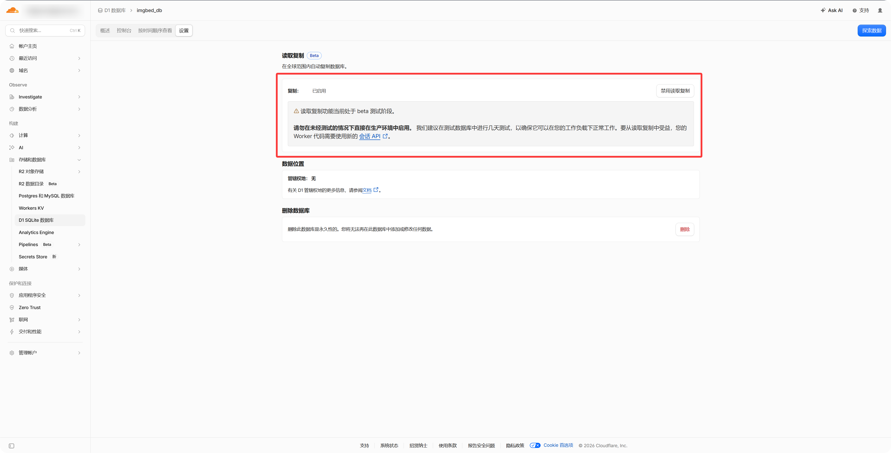

# Nastavení nahrávání

Nastavení nahrávání propojuje ImgHost s vašimi vlastními úložnými kanály. Po nastavení se nahrané obrázky a soubory ukládají do zvolené služby. ImgHost se stará o přístupové odkazy, záznamy souborů, náhledy, veřejnou galerii, API náhodného obrázku, WebDAV přístup a související postupy.

Každému může vyhovovat jiný kanál. Pokud chcete jednoduchý začátek, zkuste Telegram, Discord nebo GitHub Releases. Pokud je pro vás důležitější kapacita, rychlost a dlouhodobá stabilita, zvažte Cloudflare R2, S3, OneDrive, Google Drive, Dropbox, Yandex, pCloud nebo vlastní WebDAV.

## Než začnete

> Před prvním použitím ImgHost musíte otevřít inicializační stránku a kliknout na "Znovu sestavit index", aby se doplnily potřebné tabulky D1 a předešlo se chybám v dalších funkcích.
>
> 

### Volitelné: Zapnutí replikace čtení D1

V nastavení databáze D1 v ovládacím panelu Cloudflare zapněte replikaci čtení. Může zrychlit správu souborů, veřejnou galerii a API náhodných obrázků. ImgHost bude normálně fungovat i bez této možnosti.

- Připravte si úložný účet nebo API údaje, které chcete použít.
- Ověřte, že je vaše doména ImgHost dostupná, protože OAuth kanály potřebují URL zpětného volání.
- Po přidání kanálu nejdříve nahrajte testovací obrázek a ověřte, že se soubor uloží a otevře.

## Seznam kanálů

- [Telegram](./telegram.md)
- [Cloudflare R2](./cloudflare-r2.md)
- [S3](./s3.md)
- [WebDAV](./webdav.md)
- [Discord](./discord.md)
- [Hugging Face](./huggingface.md)
- [GitHub Releases](./github-releases.md)
- [GitLab Packages](./gitlab-packages.md)
- [OneDrive](./onedrive.md)
- [Google Drive](./google-drive.md)
- [Dropbox](./dropbox.md)
- [Yandex](./yandex.md)
- [pCloud](./pcloud.md)

## Co tato kapitola popisuje

- Jaké informace si připravit pro každý nahrávací kanál.
- Jak na externích platformách vytvořit aplikaci, zkopírovat klíče nebo autorizovat tokeny.
- Jak vyplnit konfiguraci v ImgHost a ověřit funkční nahrávání.
