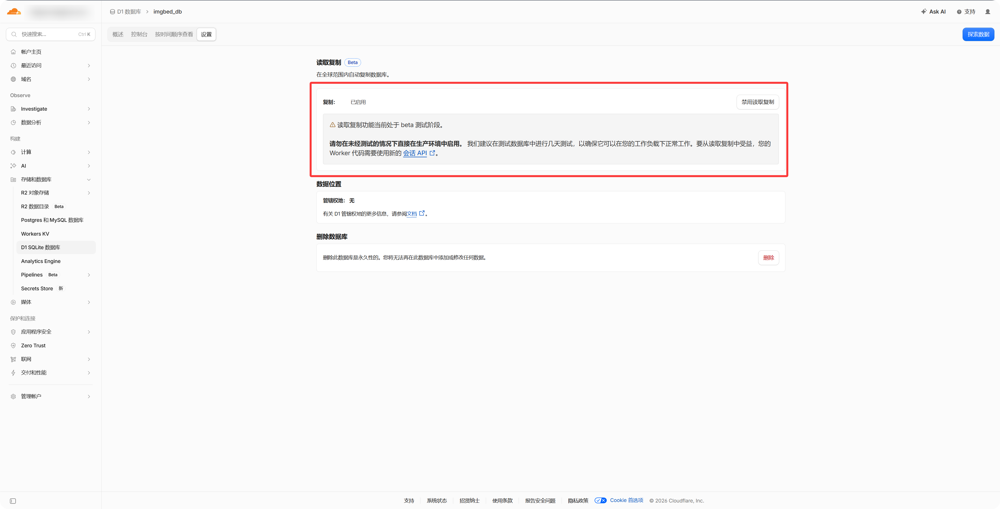

# アップロード設定

アップロード設定では、ImgHost を利用者自身のストレージチャネルに接続します。チャネルを設定すると、アップロードされた画像とファイルは選択したサービスに保存されます。その後、ImgHost はファイル記録、アクセスリンク、プレビュー、公開ギャラリー機能、ランダム画像 API アクセス、WebDAV アクセス、および関連するワークフローを管理します。

適したチャネルは利用者によって異なります。シンプルに始めたい場合は、Telegram、Discord、GitHub Releases がよい出発点になります。容量、速度、長期的な安定性をより重視する場合は、Cloudflare R2、S3、OneDrive、Google Drive、Dropbox、Yandex、pCloud、または独自の WebDAV サービスを検討してください。

## 始める前に

> ImgHost を初めて使用する前に、初期化ページで「インデックスを再構築」をクリックし、必要な D1 データテーブルを補完して、後続機能のエラーを避けてください。
>
> 

### 任意：D1 読み取りレプリケーションを有効にする

Cloudflare ダッシュボードの D1 データベース設定で「読み取りレプリケーション」を有効にすると、ファイル管理、公開ギャラリー、ランダム画像 API へのアクセスを高速化できます。有効にしなくても ImgHost は通常どおり利用できます。

- 使用するストレージアカウントまたは API 認証情報を用意します。
- OAuth ベースのチャネルではコールバック URL が必要になるため、ImgHost のドメインに到達できることを確認します。
- チャネルを追加したら、まずテスト画像をアップロードし、ファイルが正しく保存されて開けることを確認します。

## チャネル一覧

- [Telegram](./telegram.md)
- [Cloudflare R2](./cloudflare-r2.md)
- [S3](./s3.md)
- [WebDAV](./webdav.md)
- [Discord](./discord.md)
- [Hugging Face](./huggingface.md)
- [GitHub Releases](./github-releases.md)
- [GitLab Packages](./gitlab-packages.md)
- [OneDrive](./onedrive.md)
- [Google Drive](./google-drive.md)
- [Dropbox](./dropbox.md)
- [Yandex](./yandex.md)
- [pCloud](./pcloud.md)

## この章で扱う内容

- 各アップロードチャネルを設定する前に必要なもの。
- 外部プラットフォームでアプリを作成し、キーをコピーし、トークンを認可する方法。
- チャネル設定を ImgHost に入力し、アップロードが機能することを確認する方法。
