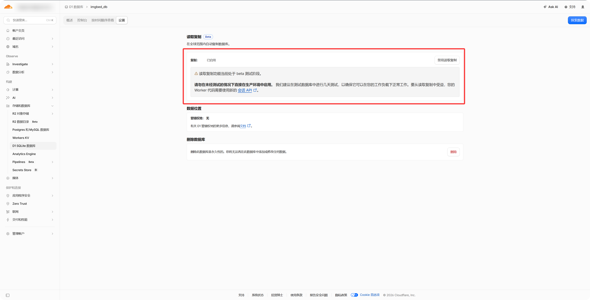

# Ustawienia przesyłania

Ustawienia przesyłania łączą ImgHost z wybranymi kanałami przechowywania. Po konfiguracji przesłane obrazy i pliki są zapisywane w wybranej usłudze, a ImgHost zarządza linkami dostępu, rekordami plików, podglądem, galerią publiczną, API losowego obrazu, dostępem WebDAV i powiązanymi funkcjami.

Różnym użytkownikom pasują różne kanały. Jeśli chcesz zacząć prosto, dobrym wyborem mogą być Telegram, Discord lub GitHub Releases. Jeśli ważniejsza jest pojemność, szybkość i stabilność na dłużej, rozważ Cloudflare R2, S3, OneDrive, Google Drive, Dropbox, Yandex, pCloud albo własny WebDAV.

## Zanim zaczniesz

> Przed pierwszym użyciem ImgHost musisz otworzyć stronę inicjalizacji i kliknąć "Odbuduj indeks", aby uzupełnić wymagane tabele D1 i uniknąć błędów w kolejnych funkcjach.
>
> 

### Opcjonalnie: włącz replikację odczytu D1

W ustawieniach bazy D1 w panelu Cloudflare włącz replikację odczytu, aby przyspieszyć dostęp do zarządzania plikami, galerii publicznej i API losowych obrazów. ImgHost działa prawidłowo również bez tej opcji.

- Przygotuj konto przechowywania lub dane API, których chcesz użyć.
- Sprawdź, czy domena ImgHost jest dostępna, ponieważ kanały OAuth wymagają adresów callback.
- Po dodaniu kanału prześlij najpierw obraz testowy, aby potwierdzić zapis i dostęp.

## Lista kanałów

- [Telegram](./telegram.md)
- [Cloudflare R2](./cloudflare-r2.md)
- [S3](./s3.md)
- [WebDAV](./webdav.md)
- [Discord](./discord.md)
- [Hugging Face](./huggingface.md)
- [GitHub Releases](./github-releases.md)
- [GitLab Packages](./gitlab-packages.md)
- [OneDrive](./onedrive.md)
- [Google Drive](./google-drive.md)
- [Dropbox](./dropbox.md)
- [Yandex](./yandex.md)
- [pCloud](./pcloud.md)

## Co opisuje ten rozdział

- Jakich informacji wymaga każdy kanał przed konfiguracją.
- Jak tworzyć aplikacje, kopiować klucze lub autoryzować tokeny na zewnętrznych platformach.
- Jak wpisać konfigurację w ImgHost i sprawdzić, czy przesyłanie działa.
